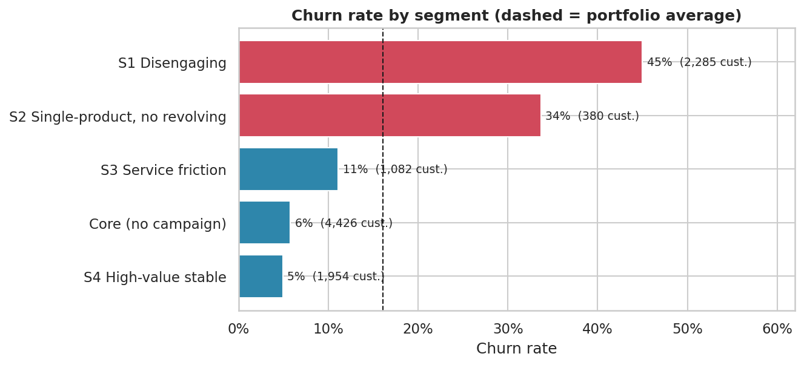

# Kredi Kartı Müşteri Kaybı (Churn) Analizi

🇬🇧 [English](README.md)

Hangi kredi kartı müşterileri ayrılıyor, neden, ve elde tutma kampanyası maliyetine değer mi?

**Sonuç:** Kayıp demografiyle değil davranışla ilişkili. "Disengaging" segmenti müşterilerin %23'ü ama ayrılanların %63'ü. Yalnızca beklenen değeri pozitif müşterilere (tabanın %24'ü) ulaşmak ayrılanların %59'una erişiyor ve bu 10.127 müşterilik portföyde tahmini **yıllık ~30,6 bin $** net fayda sağlıyor (aralık: 7,1 bin - 49,1 bin $).

📄 [Yönetici özeti (PDF)](reports/executive_summary.pdf) · 📓 [Notebook](notebooks/churn_analysis.ipynb)



## Temel bulgular

- **Churn oranı %16,1** (10.127 müşteriden 1.627'si).
- **Davranış önemli, demografi değil.** Ayrılanlar yılda 45 işlem yapmış, diğerleri 69 (Cohen's d = -1,24). Cinsiyet, eğitim, gelir ve kart tipinin etkisi ihmal edilebilir (Cramér's V ≤ 0,04).
- **Uyarı işaretleri:** az ürün, çok inaktif ay ve çok müşteri hizmetleri teması riski artırıyor (ki-kare, p < 0,001).
- **"Disengaging" segmenti %45 churn**, ortalamanın 2,8 katı.
- **Toplu kampanyalar** düşük riskli segmentlerde zarar ettiriyor. Yalnızca bireysel hedefleme kazandırıyor.

## Önerilen aksiyonlar

| Segment | Aksiyon | Churn |
|---|---|---|
| Disengaging | Harcamaya bağlı cashback + erken uyarı | %45 |
| Tek ürünlü, revolving bakiyesi yok | İkinci ürün çapraz satışı | %34 |
| Sık müşteri hizmetleri teması | Hizmet telafisi (seçici) | %11 |
| Yüksek değerli stabil | İlişki yöneticisi incelemesi (seçici) | %5 |

Her müşteri puanlanır ve yalnızca beklenen değer pozitifse aranır:
`EV = p × kurtarma_oranı × (gelir − teşvik) − (1 − p) × kullanım_oranı × teşvik − temas_maliyeti`

## Varsayımlar ve sınırlar

- Veri setinde gelir kolonu yok; gelir vekil bir ölçüdür (%1,8 interchange + revolving bakiyede %15 marj + yıllık ücret). Kampanya girdileri: 2 $ temas maliyeti, 25 $ cashback, %25 kurtarma oranı. Hepsi notebook'ta değiştirilebilir.
- Kurtarma oranı en kritik bilinmeyendir; A/B testiyle doğrulanmalıdır.
- Davranış değişkenleri müşterilerin ayrıldığı aynı 12 ayı kapsıyor; bunlar kanıtlanmış sebep değil, erken uyarı sinyalidir.

## Yöntem

pandas ile temizleme (sızıntı yapan kolonlar çıkarıldı, gizli `Unknown` değerleri duyarlılık kontrolüyle yönetildi) · etki büyüklüğü ve Holm düzeltmeli ki-kare ve t-testleri · lojistik regresyon ve karar ağacı (5 katlı CV, AUC 0,92 / 0,94) · USD senaryo analizi.

## Çalıştırma

```bash
pip install -r requirements.txt
# BankChurners.csv dosyasını data/ klasörüne indirin (bkz. data/README.md)
jupyter nbconvert --to notebook --execute --inplace notebooks/churn_analysis.ipynb
python make_summary.py
```

**Teknolojiler:** Python, pandas, SciPy, statsmodels, scikit-learn, seaborn, Jupyter